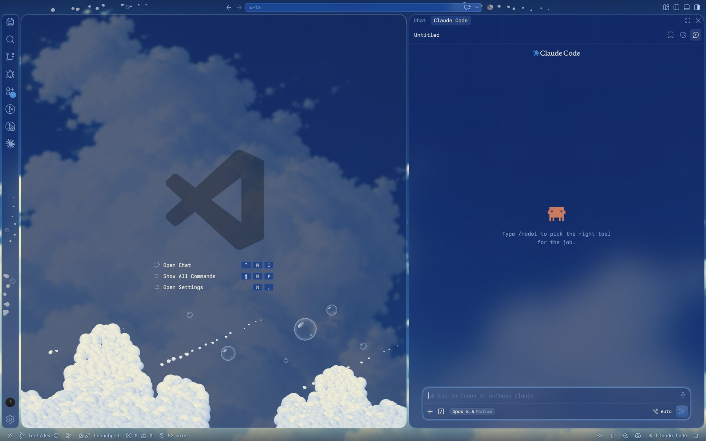

# Cumulus Glass

A sky-blue VS Code theme in the style of Apple's liquid glass. The window becomes an open sky. The sidebar, editor and panels float over it as frosted glass cards with continuous squircle corners. Small cumulus clouds drift only through empty space, never behind your code.



## Two ways to use it

Cumulus has two layers. The color themes work on their own. The glass effect needs one extra extension.

| | What you get | What you need |
|---|---|---|
| **Cumulus** | Deep-sky blue color theme with cream text, blue accents and no italics | Only the theme |
| **Cumulus Glass** | The full look: sky background, frosted cards, squircle corners, blurred menus, cloud art | The theme, plus the [Custom CSS and JS Loader](https://marketplace.visualstudio.com/items?itemName=be5invis.vscode-custom-css) extension and the glass CSS from this repo |

VS Code themes can only set colors. Blur, images and corner shapes come from CSS, so the glass effect has to be loaded separately. Use **Cumulus Glass** only together with the CSS. On its own, its backgrounds are transparent and will look broken.

## Quick start

You need VS Code, Python 3.9 or newer, and Pillow (`pip install pillow`).

```sh
git clone https://github.com/detayoo/cumulus-glass.git
cd cumulus-glass
python3 build.py --install
code --install-extension dist/cumulus-theme-1.5.2.vsix
```

Then follow [the setup guide](docs/setup.md) to turn the glass on. It takes about two minutes.

To use only the color theme, run the last command and choose **Cumulus** in **Preferences: Color Theme**.

## Docs

- [AGENTS.md](AGENTS.md): hand this to your coding agent and it will install Cumulus Glass for you, start to finish
- [Setup](docs/setup.md): installing the glass layer, and what to do after a VS Code update
- [Customizing](docs/customizing.md): tint strength, corner radius, your own sky image, the cloud art
- [How it works](docs/how-it-works.md): how the glass is faked, where the corners come from, and what each file does
- [Development](docs/development.md): design and technical rules for changing the theme itself
- [Chat panel](docs/chat-panel.md): optional glass styling for the Claude Code extension's chat panel

## Repo layout

```
build.py                    builds everything into dist/ (add --install to copy the CSS into ~/.vscode)
theme/
  build_theme.py            generates the Cumulus and Cumulus Glass color themes and the .vsix
  extension.js              companion extension: the "Cumulus: Re-apply chat panel glass" command
glass/
  cumulus-glass.template.css  the glass layer; build.py inlines the images into it
  sky.jpg                   the sky background
  bubbles.py                generates the cloud art in glass/art/
  art/                      cloud and bubble SVGs
extras/chat-panel/          optional chat panel patch (see docs/chat-panel.md)
```

## Credits

- Send and Auto icons in the chat panel patch are from [Hugeicons](https://hugeicons.com) (free set, MIT).
- The sky image and the cloud art are original to this project.

## License

MIT for the code. See [LICENSE](LICENSE) for the sky image.
